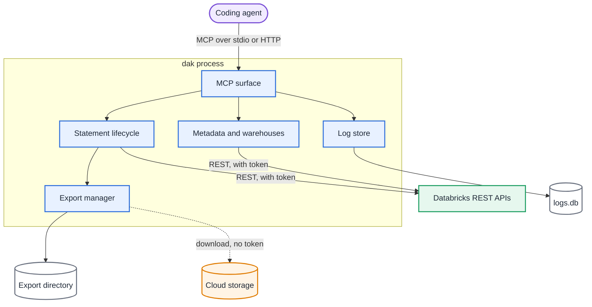
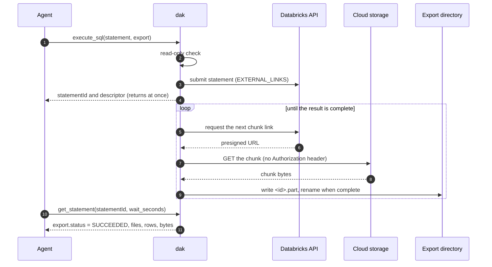

# Architecture

`dak` is one package with one binary. It runs as an MCP server on your machine, either over stdio for one session or as a
shared Streamable HTTP server. It has no backend of its own: it calls the public Databricks REST APIs with the identity you
configure, and it keeps its logs and exports on local disk.

## Components

| Component | Responsibility |
| --- | --- |
| Transport | Carries MCP over stdio, or over Streamable HTTP with loopback and token protections |
| MCP surface | The five tools and five resources. Every tool call is recorded as an execution |
| Statement lifecycle | Builds each statement, applies the read-only check, submits it, waits, cancels and shapes the bounded result |
| Export manager | Submits an export, downloads its chunks from the presigned links and writes the files |
| Metadata queries | Catalogs, schemas, tables, columns, tags, samples and lineage, through `information_schema` and Unity Catalog |
| Warehouse selection | Chooses the warehouse: explicit, configured, or the remembered automatic choice |
| Authentication | Resolves the credentials and keeps the token fresh; tokens never leave memory |
| Log store | Queues log events and writes them to SQLite in batches |

## Sequence of an export

An export is the longest path through the server, because the rows go from Databricks to a file without passing through the
agent.

## Design principles

- **Read-only by default.** Writes need an explicit switch. The check is defense in depth; the identity's privileges are the
  boundary. See [read-only mode](/guide/read-only).
- **A small tool surface.** Five tools keep the definitions short, so they cost little context in every session. See
  [ADR 0006](/adr/0006-minimal-mcp-surface).
- **REST only, no Databricks SDK.** The server uses `fetch` against public REST APIs, which keeps the dependency list short.
  See [ADR 0001](/adr/0001-rest-api-without-sdk).
- **Exports stay on the server machine.** Rows never travel through the agent's context, and the files never leave the
  machine that runs `dak` unless you move them. See [exporting results](/guide/exports).
- **stdout belongs to the protocol.** In stdio mode the server writes nothing to stdout except MCP messages. Diagnostics go to
  the log store or to stderr.

## Decisions and details

The rest of the design, with the modules, the logging policy and the delivery pipeline, is in [the design document](/design).
Each decision that shaped the system has an [ADR](/adr/).
