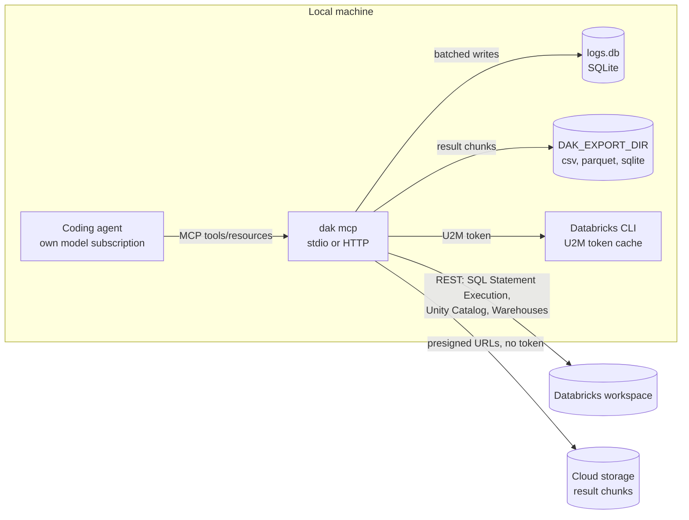

# databricks-agent-kit - Design

Status: approved for implementation (2026-10-18); revised and implemented 2026-10-19 with result export, a minimal tool surface and a logging policy. Implementation plan: [plan.md](plan.md). Decisions: [adr](adr/README.md).

## 1. Goal

Give coding agents (Claude Code, Codex, OpenCode, OmO, Cursor) autonomous, governed access to Databricks data through **our own MCP server**: run SQL and inspect Unity Catalog metadata, over stdio or Streamable HTTP, with persistent operational logs.

Skills are out of scope for the code: the official installer (`databricks aitools install`) already handles them. The README documents which official skills to avoid and how to make agents prefer this MCP when conflicting skills are installed.

### Hard constraints

| Constraint                                                          | Consequence                                                                                                        |
| ------------------------------------------------------------------- | ------------------------------------------------------------------------------------------------------------------ |
| No Databricks-served models, no AI Gateway / Unity Gateway          | Agents keep their own model subscriptions; nothing here routes inference                                           |
| No Databricks-managed MCP servers (`system.ai.*`, `/api/2.0/mcp/*`) | The MCP talks only to public workspace REST APIs                                                                   |
| No Genie                                                            | Metadata + SQL tools replace Genie-style discovery                                                                 |
| Do not assume an edition (Free, Premium, Enterprise)                | Every feature is attempted; unsupported ones fail with an explicit, actionable message                             |
| Low resource usage                                                  | TypeScript on Node.js, minimal dependencies (measured: ~72 MB RSS, ~0.7 s start vs ~126 MB, ~3 s for Python + SDK) |
| No external services for operation                                  | Logging uses a local SQLite file                                                                                   |
| Few dependencies, official Databricks capabilities first            | Only public REST APIs and `fetch` (ADR 0001); one extra dependency, `parquet-wasm` (ADR 0004)                      |

## 2. Architecture



One package, one binary (`dak`):

| Command                                                                            | Purpose                                                                                                                              |
| ---------------------------------------------------------------------------------- | ------------------------------------------------------------------------------------------------------------------------------------ |
| `dak mcp [--transport stdio\|http] [--host] [--port] [--profile] [--allow-writes]` | MCP server                                                                                                                           |
| `dak doctor [--profile]`                                                           | Check auth, warehouse, permissions, optional features, result download, export directory and log storage; report what is unsupported |

## 3. Databricks access

Only public workspace REST APIs, called with native `fetch` (no Databricks SDK dependency, ADR 0001):

| API                                                                       | Used for                                                  |
| ------------------------------------------------------------------------- | --------------------------------------------------------- |
| `POST/GET /api/2.0/sql/statements`, `.../cancel`, `.../result/chunks/{n}` | SQL execution (Statement Execution API) and result chunks |
| `GET /api/2.0/sql/warehouses`                                             | Warehouse discovery and default selection                 |
| `GET /api/2.1/unity-catalog/catalogs\|schemas\|tables`                    | Metadata, columns, comments, constraints                  |
| `system.information_schema.*` (via SQL)                                   | Search by name/comment, tags                              |
| `system.access.table_lineage` (via SQL)                                   | Lineage (optional feature)                                |
| Presigned URLs from `EXTERNAL_LINKS` (cloud storage)                      | Export downloads, sent without an `Authorization` header  |

### 3.1 Authentication

Resolution order follows Databricks unified-auth conventions:

1. Explicit profile (`--profile`): only that profile from `~/.databrickscfg` is used; environment credentials are ignored.
2. Environment: `DATABRICKS_HOST` plus either `DATABRICKS_TOKEN` (personal access token) or `DATABRICKS_CLIENT_ID` + `DATABRICKS_CLIENT_SECRET` (OAuth M2M, service principal).
3. Profile from `~/.databrickscfg` (`DATABRICKS_CONFIG_PROFILE`, else `DEFAULT`; the file can be changed with `DATABRICKS_CONFIG_FILE`):
   - `token` -> personal access token.
   - `client_id` + `client_secret` -> OAuth M2M via `POST {host}/oidc/v1/token` (`client_credentials`, scope `all-apis`).
   - `auth_type = databricks-cli` -> OAuth U2M delegated to `databricks auth token --profile <p>`; the CLI owns login, cache and refresh.
4. Anything else -> explicit error naming the profile and the supported auth types.

Tokens are cached in memory until shortly before expiry. Secrets are never logged or returned in tool output.

## 4. MCP surface

### 4.1 Tools

Kept small to limit context cost (ADR 0006). The 12 tools of the first implementation cost about 1155 tokens of definitions (4944 characters of JSON); the five tools take under 2500 characters, a budget that the tests assert. To fit it, the `$schema` URI that `zod` adds to every input schema is stripped.

| Tool              | Input                                                                                       | Output                                                                                                                                     |
| ----------------- | ------------------------------------------------------------------------------------------- | ------------------------------------------------------------------------------------------------------------------------------------------ |
| `list_objects`    | `catalog?`, `schema?`, `pattern?`, `limit?`                                                 | Catalogs, schemas or tables (name, type, comment) depending on the arguments; `truncated`                                                  |
| `describe_table`  | `full_name`, `sample_rows?`, `lineage?`                                                     | Table comment/type/owner, columns (type, nullable, comment), PK/FK constraints, clustering/partitioning, tags; optional sample and lineage |
| `search_metadata` | `query`, `catalog?`, `limit?`                                                               | Tables and columns whose name or comment matches (information_schema)                                                                      |
| `execute_sql`     | `statement`, `parameters?`, `catalog?`, `schema?`, `row_limit?`, `warehouse_id?`, `export?` | Columns, rows, row count, `truncated`, `statement_id`; or `statement_id` + state if still running; with `export`, the export descriptor    |
| `get_statement`   | `statement_id`, `wait_seconds?`, `cancel?`                                                  | State, then result when finished; progress and files for an export; `wait_seconds` (0 to 30) waits before answering; cancels when asked    |

The server sends MCP `instructions` and tool descriptions stating that these tools take precedence over the Databricks CLI for SQL and metadata.

### 4.2 Resources

| URI                                       | Content                                         |
| ----------------------------------------- | ----------------------------------------------- |
| `resource://databricks/warehouses`        | `{ warehouses[] }` with the default one marked  |
| `resource://logs/errors/recent`           | `{ generatedAt, errors[] }`                     |
| `resource://logs/executions/recent`       | `{ executions[] }`                              |
| `resource://logs/execution/{executionId}` | `{ execution, logs[] }`                         |
| `resource://logs/stats`                   | `{ last24h: { executions, errors, warnings } }` |

### 4.3 SQL execution rules

- **Read-only by default** (ADR 0008). Anything that is not a plain leading read keyword is analyzed by Databricks itself, so comments, string literals and dialect features need no handling here and nothing is executed:
  1. Statements holding a `;` before their last non-whitespace character are rejected without any call, so the check never submits several statements. Read-only mode cannot tell several statements from a `;` inside a literal; the `Read-only mode` message tells the agent to pass such literals as `:name` parameters. A single trailing `;` is accepted.
  2. Statements starting with `SHOW`, `DESCRIBE`, `DESC` or `EXPLAIN` as a whole word, preceded only by spaces, tabs or line breaks and not followed by a `:` (a SQL-scripting label), are accepted without an extra call. Comments are not skipped, so a statement that starts with a comment goes through `DESCRIBE QUERY`.
  3. All others must pass `DESCRIBE QUERY <statement>`, which succeeds only for queries.

  A read command costs no extra call and a query costs one. A parse error of the check becomes a `Read-only mode` violation whose message tells the agent to remove a leading comment. An export goes through the same check. Writes require `--allow-writes` (or `DAK_ALLOW_WRITES=true`).

- The check is defense in depth, not the security boundary: **the real boundary is the identity's Unity Catalog permissions**. The README recommends a read-only principal for agent use.
- Named parameters (`:name`) are passed through the API `parameters` field, never interpolated.
- Bounded output (ADR 0002): columns and rows as text, default `row_limit` 100, hard cap configurable (`DAK_MAX_ROWS`, default 1000), plus a byte cap on the text returned to the model; truncation is always reported.
- Long queries: wait up to 30 s (`on_wait_timeout=CONTINUE`), then return `statement_id` for `get_statement`.
- Warehouse: `warehouse_id` argument > `DATABRICKS_WAREHOUSE_ID` / profile `warehouse_id` > automatic choice (running first, then serverless, then first accessible); the choice is reported.

### 4.4 Errors and unsupported features

Databricks errors are mapped to short, actionable messages that keep the original `error_code` and SQLSTATE:

- `PERMISSION_DENIED` -> which object and which privilege is missing.
- `FEATURE_DISABLED` / missing system schema -> what is unavailable and how to enable it.
- Warehouse stopped or quota exhausted -> state and next step.
- Authentication failures -> which auth method was attempted and the manual step that fixes it.

### 4.5 Transports

| Transport                | Defaults                                                      | Security                                                                                                                                                                             |
| ------------------------ | ------------------------------------------------------------- | ------------------------------------------------------------------------------------------------------------------------------------------------------------------------------------ |
| `stdio`                  | One process per agent session; nothing but JSON-RPC on stdout | Inherits the user's credentials                                                                                                                                                      |
| `http` (Streamable HTTP) | `127.0.0.1:8765`                                              | Host-header validation (DNS rebinding protection); bearer token (`DAK_HTTP_TOKEN`) mandatory when binding to a non-loopback address; never forwards client credentials to Databricks |

HTTP mode is stateless (one MCP server instance per request) and single-identity (the server's own Databricks credential). Multi-user on-behalf-of auth is out of scope for v1.

Databricks services are created lazily on the first tool call, so the server starts (and its log resources work) even when credentials are missing; tool calls then return the authentication error and succeed once the credentials are fixed, without a restart.

### 4.6 Result export

For results too large for the agent's context (ADR 0003). `execute_sql` accepts `export: { format, name? }` with `format` equal to `csv`, `parquet` or `sqlite`; the response is immediate (`statementId`, `state: PENDING` and the export descriptor) and `get_statement` reports progress. `row_limit` and `DAK_MAX_ROWS` do not apply; the read-only check does.

- The query runs with `disposition=EXTERNAL_LINKS`: `CSV`, `ARROW_STREAM` or `JSON_ARRAY` for the three formats. Databricks splits the result into chunks (about 21 MB each) and returns one presigned URL per chunk, valid for 15 minutes at most.
- Each export is a background job in its own log execution. It polls the statement (waits of 1 s growing to 10 s, without an upper bound: a statement stuck in `PENDING` or `RUNNING` is polled until Databricks ends it or the job is cancelled), then downloads the chunks and writes them to the format's sink strictly in `chunk_index` order. At most 4 downloads are in flight and no more than 8 chunks are ahead of the one being written, so memory stays bounded.
- Downloads are plain `GET` requests without an `Authorization` header. The link of the first chunk comes with the result; the others are requested from `.../result/chunks/{n}` just before their download. A network error, `429` or `5xx` is retried up to 3 times with waits of 500, 1000 and 2000 ms; an expired link or a `403` gets one fresh link; any other status fails the export. The first failure aborts the job at once. URLs carry credentials and are never logged.
- Files are written only under `DAK_EXPORT_DIR`. The agent can only suggest a `name` (sanitized to `[A-Za-z0-9._-]`, 64 characters); the export id is `<name or "export">-<full statement id>` (the statement id is sanitized to the same characters and not cut, because time-ordered statement ids share their first characters for minutes). The directory is created with mode `0700` outside Windows. If the target path already exists (or an export is running for it), the manager cancels the statement it just submitted and rejects the call. Each output is written as `.part` and renamed when complete.
- `csv`: one `<id>.csv.part` renamed to `<id>.csv`; chunks are appended as downloaded, in order (only the first one has a header). SQL `NULL` is written by Databricks as the text `null`.
- `parquet`: `part-NNNNN.parquet` per chunk, converted from the `ARROW_STREAM` chunk with `parquet-wasm` (ZSTD), keeping all types (ADR 0004). The files are written into the directory `<id>.part/`, which is renamed to `<id>` when the last chunk is written; with no chunks the final directory is empty.
- `sqlite`: `<id>.db.part` renamed to `<id>.db`, with a table `result` loaded from `JSON_ARRAY` chunks with `node:sqlite`, one transaction per chunk. Values are bound as text and converted by column affinity: integers to `INTEGER` (exact for `BIGINT`), `BOOLEAN` to 0/1, floats and `DECIMAL` of up to 15 digits to `REAL`, longer `DECIMAL` and everything else to `TEXT`; `STRUCT`, `ARRAY` and `MAP` are JSON text.
- States: `PENDING` (query running in Databricks), `DOWNLOADING` with `{ chunksDone, chunksTotal, rows, bytes }`, `SUCCEEDED` with `{ files, rows, bytes, truncated }`, `FAILED` with `error`, `CANCELED`. `get_statement` with `wait_seconds` (0 to 30) waits up to that time for the export to end. With `cancel: true` it aborts the local job (which deletes the partial files) and cancels the statement in Databricks. On shutdown every running export is cancelled.
- Limits: `DAK_EXPORT_MAX_BYTES` (sent as `byte_limit`; a result cut at the limit ends `SUCCEEDED` with `truncated: true`); jobs live in the process and are not resumed after a restart; finished exports are never deleted; partitioning by column is not offered. At startup `cleanupOrphanedParts` removes `.part` files and directories of the export directory that were last modified more than 24 hours earlier; it needs no credentials, so it does not wait for the first tool call.
- `dak doctor` checks that a result chunk can be downloaded (a `SELECT 1` export) and that the export directory is writable.

## 5. Configuration

| Setting           | Flag                | Environment                       | Default                     |
| ----------------- | ------------------- | --------------------------------- | --------------------------- |
| Profile           | `--profile`         | `DATABRICKS_CONFIG_PROFILE`       | `DEFAULT`                   |
| Warehouse         | -                   | `DATABRICKS_WAREHOUSE_ID`         | automatic                   |
| Allow writes      | `--allow-writes`    | `DAK_ALLOW_WRITES`                | `false`                     |
| Max rows          | -                   | `DAK_MAX_ROWS`                    | `1000`                      |
| Transport         | `--transport`       | -                                 | `stdio`                     |
| HTTP host / port  | `--host` / `--port` | `DAK_HTTP_HOST` / `DAK_HTTP_PORT` | `127.0.0.1` / `8765`        |
| HTTP token        | -                   | `DAK_HTTP_TOKEN`                  | required off-loopback       |
| Storage directory | -                   | `DAK_STORAGE_DIR`                 | per-user state directory    |
| Export directory  | -                   | `DAK_EXPORT_DIR`                  | `<state directory>/exports` |
| Export size cap   | -                   | `DAK_EXPORT_MAX_BYTES`            | 10 GiB                      |
| Log level         | -                   | `DAK_LOG_LEVEL`                   | `info`                      |

The per-user state directory is `%LOCALAPPDATA%\databricks-agent-kit` on Windows and `$XDG_STATE_HOME/databricks-agent-kit` (default `~/.local/state/databricks-agent-kit`) elsewhere. A relative `DAK_EXPORT_DIR` is resolved against the working directory of the server process; the settings reject non-positive or non-numeric `DAK_EXPORT_MAX_BYTES`.

## 6. Logging and diagnostics

Implements the logging specification v1.0 provided by the user (persistence, traceability, diagnostics, 90-day retention, resources, no external services). This section records how it maps to the code and the deliberate adjustments.

### 6.1 Components

```text
MCP runtime (tools, resources) -> LogService -> in-memory FIFO queue -> BatchWriter -> SQLite repository -> logs.db
```

- **SQLite driver:** `node:sqlite` (built into Node.js, no native module) instead of `better-sqlite3`. Node.js flags it as experimental; its startup warning is suppressed and the repository interface isolates the driver if it ever has to change.
- **Event generation:** small in-house logger (levels, category, source, metadata, stack trace) instead of `pino`. Nothing is ever written to stdout.

### 6.2 Data model

As specified: `Execution` (`executionId`, `startedAt`, `finishedAt?`, `transport`, `toolName?`, `promptName?`, `resourceUri?`, `status`) and `LogEntry` (`id?`, `executionId`, `timestamp`, `level`, `category?`, `source?`, `message`, `metadata?`, `stackTrace?`). Tables `executions` and `logs` and the four mandatory indexes exactly as in the specification, plus `ON DELETE CASCADE` on `logs.execution_id`. Execution ids are UUID v7 (generated in-house; Node.js only ships v4).

### 6.3 Flow

- Every tool call opens an execution (`started`), logs its events, and closes it as `completed`, `failed` or `cancelled`. Each export runs as a further execution of its own (tool name `export`), because it outlives the call that started it. Reads of the `resource://logs/*` resources are not recorded, so diagnosing does not inflate the statistics.
- Server-level events (startup, shutdown, purge, transport errors) belong to one **lifecycle execution** per process, because `logs.execution_id` is mandatory.
- Execution inserts/updates and log entries all go through the same FIFO queue, so a log entry is never written before its execution row.
- Flush when 100 events are pending or 5 s have passed since the last flush; each flush is one transaction. The queue is also flushed on shutdown (`SIGINT`, `SIGTERM`, stdin end, `beforeExit`) to keep the loss window to an abrupt crash.
- Purge at startup and every 24 h: executions with `started_at` older than 90 days (cascading their logs), then any remaining logs older than 90 days.

### 6.4 Adjustments to the specification

| Topic         | Specification                                                     | Adjustment                                                                                                                                         | Reason                                                                                                               |
| ------------- | ----------------------------------------------------------------- | -------------------------------------------------------------------------------------------------------------------------------------------------- | -------------------------------------------------------------------------------------------------------------------- |
| Libraries     | `pino`, `better-sqlite3`                                          | In-house logger, `node:sqlite`                                                                                                                     | Decided with the user: zero extra dependencies and no native module                                                  |
| Storage path  | `.storage/logs.db`                                                | Per-user state directory, overridable with `DAK_STORAGE_DIR`                                                                                       | In stdio mode the working directory is each agent's project; a relative path would scatter databases across projects |
| PRAGMAs       | WAL, `synchronous=NORMAL`, `foreign_keys=ON`, `temp_store=MEMORY` | Same, plus `busy_timeout=5000`                                                                                                                     | Several stdio processes share one database file                                                                      |
| Foreign key   | `logs -> executions`                                              | `ON DELETE CASCADE`                                                                                                                                | With `foreign_keys=ON`, purging an execution whose logs are newer than the cut-off would otherwise fail              |
| Server events | Not covered                                                       | Lifecycle execution per process                                                                                                                    | `execution_id` is `NOT NULL`                                                                                         |
| Thread safety | Thread-safe queue                                                 | Plain in-process FIFO array                                                                                                                        | Node.js runs the queue on a single thread; FIFO and concurrent `push` from async handlers hold                       |
| Content       | Full traces                                                       | Tool name, SQL text (first 4 KB), parameter names and types (never values), duration, result summary, errors; never result rows, tokens or secrets | Keep the database small and free of business data and credentials                                                    |
| Prompts       | Prompt executions                                                 | Supported by the model; this server registers no prompts                                                                                           | YAGNI                                                                                                                |

### 6.5 Logging policy

ADR 0007. Structured events, correlation by identifier, levels with meaning, nothing that will not be analyzed.

| Event                               | Level                         | Content                                                                                                                   |
| ----------------------------------- | ----------------------------- | ------------------------------------------------------------------------------------------------------------------------- |
| Tool call, one entry when it ends   | `info`                        | Tool, arguments, duration, `statementId`, `warehouseId`, state, row count, `truncated`, `checkMs`                         |
| Expected failure (`DakError`)       | `warn`, no stack trace        | Read-only violation, invalid argument, `PERMISSION_DENIED`, SQL errors                                                    |
| Unexpected failure                  | `error` with stack trace      | Anything that is not a `DakError`                                                                                         |
| HTTP retry to Databricks            | `warn`                        | Status, attempt, wait                                                                                                     |
| Export download retry, link renewal | `warn`                        | Chunk, attempt, wait, status or error; never the URL                                                                      |
| Automatic warehouse choice          | `info`, once                  | Warehouse and reason                                                                                                      |
| Token refresh, each HTTP request    | `debug`                       | Method, path without identifiers, status, milliseconds                                                                    |
| Export start and end                | `info`                        | Format, rows, chunks, bytes, duration; a failure is `warn` or `error` by the rule above; per-chunk detail only at `debug` |
| HTTP `401` of the MCP transport     | `warn`, at most once a minute | Counter of suppressed events; never the token or headers                                                                  |

A failed tool call writes exactly one entry: `ExecutionHandle.fail(error, metadata?)` logs the error at the level above with the same arguments, duration and diagnostics that the `info` entry of a successful call carries, so there is never an `info` entry and a failure entry for the same call.

## 7. Repository layout

```text
databricks-agent-kit/
  package.json            # bin: dak
  tsconfig.json
  src/
    cli.ts                # argument parsing, command dispatch
    config.ts             # env, profile, options
    auth.ts               # PAT, OAuth M2M, CLI-delegated U2M
    client.ts             # fetch wrapper, retries, error mapping
    sql.ts                # statement execution, read-only check, result shaping
    metadata.ts           # catalogs, schemas, tables, search, lineage
    export/               # background export jobs: chunk download, csv, parquet, sqlite
    logging/              # log service, queue, batch writer, repository, uuid v7, argument description, rate limiter
    server.ts             # MCP tools, resources, transports
    doctor.ts             # environment checks
  test/                   # node:test
  docs/design.md
  docs/plan.md
  docs/adr/               # architecture decision records
  README.md
```

Runtime dependencies: `@modelcontextprotocol/server` (MCP SDK v2), `@modelcontextprotocol/node` (HTTP transport), `commander`, `zod`, and `parquet-wasm` (Parquet export, pinned to an exact version). Dev: `typescript`, `@types/node`. Tests use the built-in `node:test`. Node.js >= 22.13 (`node:sqlite` unflagged); developed on Node.js 24.

## 8. README requirements

- **Authentication:** every supported method (OAuth U2M through the CLI, personal access token, OAuth M2M with a service principal), how to configure each, the resolution order, and the manual actions required (install/upgrade the CLI, `databricks auth login`, choose or create a warehouse, grant permissions, create a read-only principal for agents, PAT or service principal creation where applicable).
- **Agent registration:** snippets for Claude Code, Codex, OpenCode and Cursor, for stdio and HTTP.
- **Skills coexistence:** if the official Databricks skills are installed and include the conflicting ones (`databricks-data-discovery`, `databricks-genie-agents`, `databricks-unity-gateway`, and any skill that tells the agent to run `databricks experimental aitools tools query|discover-schema|statement`, notably `databricks-core`), add a tiebreak note to the global `AGENTS.md` (and `CLAUDE.md` for Claude Code) giving precedence to this MCP. The README provides the exact text.
- **Logging:** location, retention, resources and the logging policy.
- **Exports:** formats, `DAK_EXPORT_DIR`, the `null` caveat of CSV and the SQLite type mapping.

## 9. Verification strategy

| Level       | What                                                                                                                                                                                                                        | How                                                                     |
| ----------- | --------------------------------------------------------------------------------------------------------------------------------------------------------------------------------------------------------------------------- | ----------------------------------------------------------------------- |
| Unit        | Read-only check, config/profile parsing, auth selection, result shaping, error mapping, UUID v7, queue/flush, repository, purge, SQLite type mapping, ordered CSV concatenation, atomic rename, name sanitizing, log levels | `node --test`, written test-first; `fetch` stubbed at the HTTP boundary |
| End to end  | MCP client spawns `dak mcp` over stdio and connects over HTTP against a local stub of the Databricks REST API and a presigned-URL origin: list tools/resources, `execute_sql`, exports, cancellation, an error path         | MCP client SDK in `node:test`                                           |
| Integration | Real workspace: auth, warehouse selection, SQL, metadata, lineage or its "unsupported" message, multi-chunk CSV, Arrow to Parquet with `NULL`, `DATE`, `BINARY` and `MAP`, `byte_count` against the downloaded size         | Gated by `DAK_IT_PROFILE`; skipped otherwise                            |
| Agent       | Claude Code / OpenCode answer a data question using MCP tool calls                                                                                                                                                          | Manual run, documented in the README                                    |
