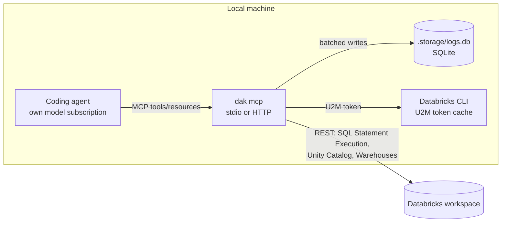

# databricks-agent-kit - Design

Status: approved for implementation (2026-10-18). Implementation plan: [plan.md](plan.md).

## 1. Goal

Give coding agents (Claude Code, Codex, OpenCode, OmO, Cursor) autonomous, governed access to Databricks data through **our own MCP server**: run SQL and inspect Unity Catalog metadata, over stdio or Streamable HTTP, with persistent operational logs.

Skills are out of scope for the code: the official installer (`databricks aitools install`) already handles them. The README documents which official skills to avoid and how to make agents prefer this MCP when conflicting skills are installed.

### Hard constraints

| Constraint                                                          | Consequence                                                                                                        |
| ------------------------------------------------------------------- | ------------------------------------------------------------------------------------------------------------------ |
| No Databricks-served models, no AI Gateway / Unity Gateway          | Agents keep their own model subscriptions; nothing here routes inference                                           |
| No Databricks-managed MCP servers (`system.ai.*`, `/api/2.0/mcp/*`) | The MCP talks only to public workspace REST APIs                                                                   |
| No Genie                                                            | Metadata + SQL tools replace Genie-style discovery                                                                 |
| Do not assume an edition (Free, Premium, Enterprise)                | Every feature is attempted; unsupported ones fail with an explicit, actionable message                             |
| Low resource usage                                                  | TypeScript on Node.js, minimal dependencies (measured: ~72 MB RSS, ~0.7 s start vs ~126 MB, ~3 s for Python + SDK) |
| No external services for operation                                  | Logging uses a local SQLite file                                                                                   |

## 2. Architecture



One package, one binary (`dak`):

| Command                                                                            | Purpose                                                                                           |
| ---------------------------------------------------------------------------------- | ------------------------------------------------------------------------------------------------- |
| `dak mcp [--transport stdio\|http] [--host] [--port] [--profile] [--allow-writes]` | MCP server                                                                                        |
| `dak doctor [--profile]`                                                           | Check auth, warehouse, permissions, optional features and log storage; report what is unsupported |

## 3. Databricks access

Only public workspace REST APIs, called with native `fetch` (no Databricks SDK dependency):

| API                                                                       | Used for                                  |
| ------------------------------------------------------------------------- | ----------------------------------------- |
| `POST/GET /api/2.0/sql/statements`, `.../cancel`, `.../result/chunks/{n}` | SQL execution (Statement Execution API)   |
| `GET /api/2.0/sql/warehouses`                                             | Warehouse discovery and default selection |
| `GET /api/2.1/unity-catalog/catalogs\|schemas\|tables`                    | Metadata, columns, comments, constraints  |
| `system.information_schema.*` (via SQL)                                   | Search by name/comment, tags              |
| `system.access.table_lineage` (via SQL)                                   | Lineage (optional feature)                |

### 3.1 Authentication

Resolution order follows Databricks unified-auth conventions:

1. Environment: `DATABRICKS_HOST` plus either `DATABRICKS_TOKEN` (personal access token) or `DATABRICKS_CLIENT_ID` + `DATABRICKS_CLIENT_SECRET` (OAuth M2M, service principal).
2. Profile from `~/.databrickscfg` (`--profile` / `DATABRICKS_CONFIG_PROFILE`, else `DEFAULT`):
   - `token` -> personal access token.
   - `client_id` + `client_secret` -> OAuth M2M via `POST {host}/oidc/v1/token` (`client_credentials`, scope `all-apis`).
   - `auth_type = databricks-cli` -> OAuth U2M delegated to `databricks auth token --profile <p>`; the CLI owns login, cache and refresh.
3. Anything else -> explicit error naming the profile and the supported auth types.

Tokens are cached in memory until shortly before expiry. Secrets are never logged or returned in tool output.

## 4. MCP surface

### 4.1 Tools

Kept small to limit context cost.

| Tool               | Input                                                                            | Output                                                                                                        |
| ------------------ | -------------------------------------------------------------------------------- | ------------------------------------------------------------------------------------------------------------- |
| `list_warehouses`  | -                                                                                | id, name, state, size, serverless, which one is the default                                                   |
| `list_catalogs`    | -                                                                                | name, comment                                                                                                 |
| `list_schemas`     | `catalog`                                                                        | name, comment                                                                                                 |
| `list_tables`      | `catalog`, `schema`, `name_pattern?`                                             | name, type, comment                                                                                           |
| `describe_table`   | `full_name`                                                                      | table comment/type/owner, columns (type, nullable, comment), PK/FK constraints, clustering/partitioning, tags |
| `search_metadata`  | `query`, `catalog?`, `limit?`                                                    | tables and columns whose name or comment matches (information_schema)                                         |
| `sample_table`     | `full_name`, `limit?`                                                            | first rows (bounded)                                                                                          |
| `execute_sql`      | `statement`, `parameters?`, `catalog?`, `schema?`, `row_limit?`, `warehouse_id?` | columns, rows, row count, `truncated`, `statement_id`; or `statement_id` + state if still running             |
| `get_statement`    | `statement_id`                                                                   | state, then result when finished                                                                              |
| `cancel_statement` | `statement_id`                                                                   | confirmation                                                                                                  |
| `table_lineage`    | `full_name`, `direction?`                                                        | upstream/downstream tables; explicit "unsupported" if system tables are not available                         |
| `search_logs`      | `level?`, `text?`, `executionId?`, `from?`, `to?`, `limit?`                      | matching log entries and total (see section 6)                                                                |

The server sends MCP `instructions` and tool descriptions stating that these tools take precedence over the Databricks CLI for SQL and metadata.

### 4.2 Resources

| URI                                       | Content                                         |
| ----------------------------------------- | ----------------------------------------------- |
| `resource://logs/errors/recent`           | `{ generatedAt, errors[] }`                     |
| `resource://logs/executions/recent`       | `{ executions[] }`                              |
| `resource://logs/execution/{executionId}` | `{ execution, logs[] }`                         |
| `resource://logs/stats`                   | `{ last24h: { executions, errors, warnings } }` |

### 4.3 SQL execution rules

- **Read-only by default.** A guard accepts one statement whose first keyword is `SELECT`, `WITH`, `SHOW`, `DESCRIBE`/`DESC`, `EXPLAIN` or `VALUES`, after stripping comments and string literals; `WITH` statements containing DML are rejected. Writes require `--allow-writes` (or `DAK_ALLOW_WRITES=true`).
- The guard is defense in depth, not the security boundary: **the real boundary is the identity's Unity Catalog permissions**. The README recommends a read-only principal for agent use.
- Named parameters (`:name`) are passed through the API `parameters` field, never interpolated.
- Bounded output: default `row_limit` 100, hard cap configurable (`DAK_MAX_ROWS`, default 1000), plus a byte cap on the text returned to the model; truncation is always reported.
- Long queries: wait up to 30 s (`on_wait_timeout=CONTINUE`), then return `statement_id` for `get_statement` / `cancel_statement`.
- Warehouse: `warehouse_id` argument > `DATABRICKS_WAREHOUSE_ID` / profile `warehouse_id` > automatic choice (running first, then serverless, then first accessible); the choice is reported.

### 4.4 Errors and unsupported features

Databricks errors are mapped to short, actionable messages that keep the original `error_code` and SQLSTATE:

- `PERMISSION_DENIED` -> which object and which privilege is missing.
- `FEATURE_DISABLED` / missing system schema -> what is unavailable and how to enable it.
- Warehouse stopped or quota exhausted -> state and next step.
- Authentication failures -> which auth method was attempted and the manual step that fixes it.

### 4.5 Transports

| Transport                | Defaults                                                      | Security                                                                                                                                                                             |
| ------------------------ | ------------------------------------------------------------- | ------------------------------------------------------------------------------------------------------------------------------------------------------------------------------------ |
| `stdio`                  | One process per agent session; nothing but JSON-RPC on stdout | Inherits the user's credentials                                                                                                                                                      |
| `http` (Streamable HTTP) | `127.0.0.1:8765`                                              | Host-header validation (DNS rebinding protection); bearer token (`DAK_HTTP_TOKEN`) mandatory when binding to a non-loopback address; never forwards client credentials to Databricks |

HTTP mode is stateless (one MCP server instance per request) and single-identity (the server's own Databricks credential). Multi-user on-behalf-of auth is out of scope for v1.

Databricks services are created lazily on the first tool call, so the server starts (and its log resources work) even when credentials are missing; tool calls then return the authentication error and succeed once the credentials are fixed, without a restart.

## 5. Configuration

| Setting           | Flag                | Environment                       | Default                  |
| ----------------- | ------------------- | --------------------------------- | ------------------------ |
| Profile           | `--profile`         | `DATABRICKS_CONFIG_PROFILE`       | `DEFAULT`                |
| Warehouse         | -                   | `DATABRICKS_WAREHOUSE_ID`         | automatic                |
| Allow writes      | `--allow-writes`    | `DAK_ALLOW_WRITES`                | `false`                  |
| Max rows          | -                   | `DAK_MAX_ROWS`                    | `1000`                   |
| Transport         | `--transport`       | -                                 | `stdio`                  |
| HTTP host / port  | `--host` / `--port` | `DAK_HTTP_HOST` / `DAK_HTTP_PORT` | `127.0.0.1` / `8765`     |
| HTTP token        | -                   | `DAK_HTTP_TOKEN`                  | required off-loopback    |
| Storage directory | -                   | `DAK_STORAGE_DIR`                 | `<install dir>/.storage` |
| Log level         | -                   | `DAK_LOG_LEVEL`                   | `info`                   |

## 6. Logging and diagnostics

Implements the logging specification v1.0 provided by the user (persistence, traceability, diagnostics, 90-day retention, resources, `search_logs`, no external services). This section records how it maps to the code and the deliberate adjustments.

### 6.1 Components

```text
MCP runtime (tools, resources) -> LogService -> in-memory FIFO queue -> BatchWriter -> SQLite repository -> .storage/logs.db
```

- **SQLite driver:** `node:sqlite` (built into Node.js, no native module) instead of `better-sqlite3`. Node.js flags it as experimental; its startup warning is suppressed and the repository interface isolates the driver if it ever has to change.
- **Event generation:** small in-house logger (levels, category, source, metadata, stack trace) instead of `pino`. Nothing is ever written to stdout.

### 6.2 Data model

As specified: `Execution` (`executionId`, `startedAt`, `finishedAt?`, `transport`, `toolName?`, `promptName?`, `resourceUri?`, `status`) and `LogEntry` (`id?`, `executionId`, `timestamp`, `level`, `category?`, `source?`, `message`, `metadata?`, `stackTrace?`). Tables `executions` and `logs` and the four mandatory indexes exactly as in the specification, plus `ON DELETE CASCADE` on `logs.execution_id`. Execution ids are UUID v7 (generated in-house; Node.js only ships v4).

### 6.3 Flow

- Every tool call and resource read opens an execution (`started`), logs its events, and closes it as `completed`, `failed` (exception + stack trace) or `cancelled`.
- Server-level events (startup, shutdown, purge, transport errors) belong to one **lifecycle execution** per process, because `logs.execution_id` is mandatory.
- Execution inserts/updates and log entries all go through the same FIFO queue, so a log entry is never written before its execution row.
- Flush when 100 events are pending or 5 s have passed since the last flush; each flush is one transaction. The queue is also flushed on shutdown (`SIGINT`, `SIGTERM`, stdin end, `beforeExit`) to keep the loss window to an abrupt crash.
- Purge at startup and every 24 h: executions with `started_at` older than 90 days (cascading their logs), then any remaining logs older than 90 days.

### 6.4 Adjustments to the specification

| Topic         | Specification                                                     | Adjustment                                                                                                                                    | Reason                                                                                                               |
| ------------- | ----------------------------------------------------------------- | --------------------------------------------------------------------------------------------------------------------------------------------- | -------------------------------------------------------------------------------------------------------------------- |
| Libraries     | `pino`, `better-sqlite3`                                          | In-house logger, `node:sqlite`                                                                                                                | Decided with the user: zero extra dependencies and no native module                                                  |
| Storage path  | `.storage/logs.db`                                                | Resolved against the install directory, overridable with `DAK_STORAGE_DIR`                                                                    | In stdio mode the working directory is each agent's project; a relative path would scatter databases across projects |
| PRAGMAs       | WAL, `synchronous=NORMAL`, `foreign_keys=ON`, `temp_store=MEMORY` | Same, plus `busy_timeout=5000`                                                                                                                | Several stdio processes share one database file                                                                      |
| Foreign key   | `logs -> executions`                                              | `ON DELETE CASCADE`                                                                                                                           | With `foreign_keys=ON`, purging an execution whose logs are newer than the cut-off would otherwise fail              |
| Server events | Not covered                                                       | Lifecycle execution per process                                                                                                               | `execution_id` is `NOT NULL`                                                                                         |
| Thread safety | Thread-safe queue                                                 | Plain in-process FIFO array                                                                                                                   | Node.js runs the queue on a single thread; FIFO and concurrent `push` from async handlers hold                       |
| Content       | Full traces                                                       | Tool name, arguments (SQL text), duration, result summary (row count, truncation, statement id), errors; never result rows, tokens or secrets | Keep the database small and free of business data and credentials                                                    |
| Prompts       | Prompt executions                                                 | Supported by the model; this server registers no prompts                                                                                      | YAGNI                                                                                                                |

## 7. Repository layout

```text
databricks-agent-kit/
  package.json            # bin: dak
  tsconfig.json
  src/
    cli.ts                # argument parsing, command dispatch
    config.ts             # env, profile, options
    auth.ts               # PAT, OAuth M2M, CLI-delegated U2M
    client.ts             # fetch wrapper, retries, error mapping
    sql.ts                # statement execution, guard, result shaping
    metadata.ts           # catalogs, schemas, tables, search, lineage
    logging/              # log service, queue, batch writer, repository, uuid v7
    server.ts             # MCP tools, resources, transports
    doctor.ts             # environment checks
  test/                   # node:test
  docs/design.md
  docs/plan.md
  README.md
```

Runtime dependencies: `@modelcontextprotocol/server` (MCP SDK v2), `@modelcontextprotocol/node` (HTTP transport), `zod`. Dev: `typescript`, `@types/node`. Tests use the built-in `node:test`. Node.js >= 22.13 (`node:sqlite` unflagged); developed on Node.js 24.

## 8. README requirements

- **Authentication:** every supported method (OAuth U2M through the CLI, personal access token, OAuth M2M with a service principal), how to configure each, the resolution order, and the manual actions required (install/upgrade the CLI, `databricks auth login`, choose or create a warehouse, grant permissions, create a read-only principal for agents, PAT or service principal creation where applicable).
- **Agent registration:** snippets for Claude Code, Codex, OpenCode and Cursor, for stdio and HTTP.
- **Skills coexistence:** if the official Databricks skills are installed and include the conflicting ones (`databricks-data-discovery`, `databricks-genie-agents`, `databricks-unity-gateway`, and any skill that tells the agent to run `databricks experimental aitools tools query|discover-schema|statement`, notably `databricks-core`), add a tiebreak note to the global `AGENTS.md` (and `CLAUDE.md` for Claude Code) giving precedence to this MCP. The README provides the exact text.
- **Logging:** location, retention, resources and `search_logs`.

## 9. Verification strategy

| Level       | What                                                                                                                                                                                                           | How                                                                     |
| ----------- | -------------------------------------------------------------------------------------------------------------------------------------------------------------------------------------------------------------- | ----------------------------------------------------------------------- |
| Unit        | Guard, config/profile parsing, auth selection, result shaping, error mapping, UUID v7, queue/flush, repository, purge                                                                                          | `node --test`, written test-first; `fetch` stubbed at the HTTP boundary |
| End to end  | MCP client spawns `dak mcp` over stdio and connects over HTTP against a local stub of the Databricks REST API: list tools/resources, `execute_sql`, `describe_table`, an error path, logs visible in resources | MCP client SDK in `node:test`                                           |
| Integration | Real workspace: auth, warehouse selection, SQL, metadata, lineage or its "unsupported" message                                                                                                                 | Gated by `DAK_IT_PROFILE`; skipped otherwise                            |
| Agent       | Claude Code / OpenCode answer a data question using MCP tool calls                                                                                                                                             | Manual run, documented in the README                                    |
