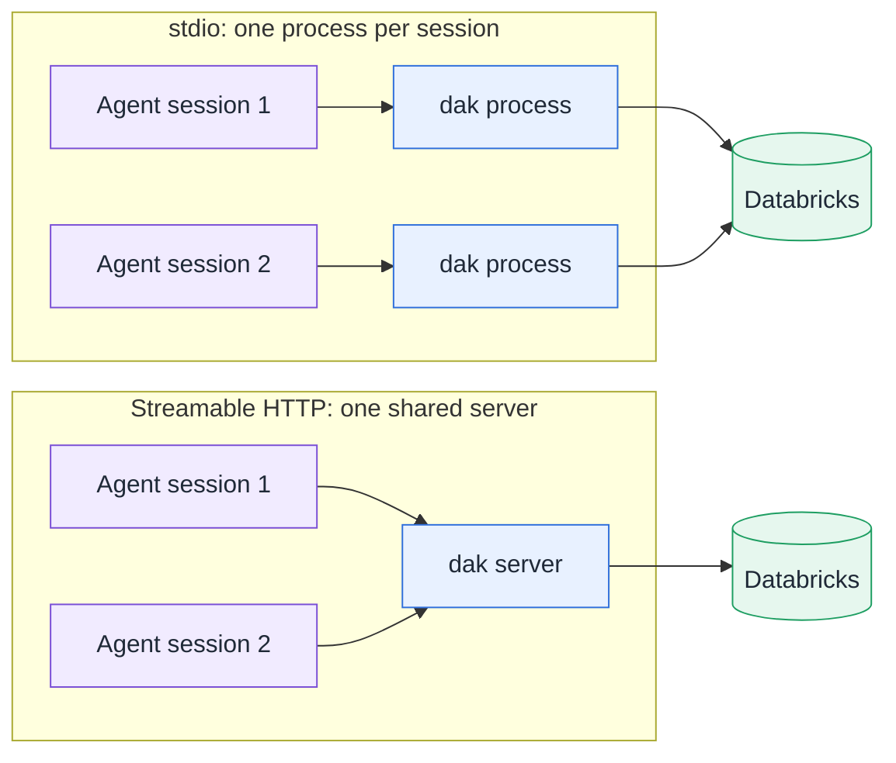

# Connect your agent

Examples use a profile named `dev`, as in the [quickstart](/guide/quickstart). If you did not run `npm link`, replace
`dak` with `node <absolute-path>/dist/cli.js`.

`dak` runs in one of two transports:

- **stdio**: the agent starts one `dak` process per session. Nothing is listening on the network.
- **Streamable HTTP**: one server runs on your machine and every agent connects to its URL.



Use stdio unless you need one shared server, for example to keep one log view across several agents or to run the server
on a remote machine behind a proxy.

## stdio

::: code-group

```bash [Claude Code]
claude mcp add --scope user databricks -- dak mcp --profile dev
```

```toml [Codex · ~/.codex/config.toml]
[mcp_servers.databricks]
command = "dak"
args = ["mcp", "--profile", "dev"]
```

```json [OpenCode · opencode.json]
{
  "mcp": {
    "databricks": {
      "type": "local",
      "command": ["dak", "mcp", "--profile", "dev"],
      "enabled": true
    }
  }
}
```

```json [Cursor · ~/.cursor/mcp.json]
{
  "mcpServers": {
    "databricks": { "command": "dak", "args": ["mcp", "--profile", "dev"] }
  }
}
```

:::

::: tip Windows
Some clients cannot launch `dak.cmd`. Set `command` to `node` and pass the absolute path to `dist/cli.js` as the first
argument, followed by `mcp --profile dev`.
:::

## Streamable HTTP

Start the server once:

```bash
dak mcp --transport http --profile dev            # http://127.0.0.1:8765/mcp
```

Then point the clients at the URL:

::: code-group

```bash [Claude Code]
claude mcp add --transport http databricks http://127.0.0.1:8765/mcp
```

```json [OpenCode · opencode.json]
{
  "mcp": {
    "databricks": {
      "type": "remote",
      "url": "http://127.0.0.1:8765/mcp",
      "enabled": true
    }
  }
}
```

:::

How the HTTP transport protects the server:

- **Loopback only by default.** Requests with a foreign `Host` header are rejected (DNS rebinding protection). On loopback,
  browser requests from a non-local `Origin` are rejected too.
- **Token off loopback.** Binding to another address, for example `--host 0.0.0.0`, requires `DAK_HTTP_TOKEN` with at
  least 32 characters. Generate one with `openssl rand -hex 32`. Clients then send `Authorization: Bearer <token>`. The
  token can also be set on loopback. For Claude Code, add `--header "Authorization: Bearer <token>"` to the command above.
- **TLS is your job.** The server speaks plain HTTP. Off loopback, put it behind a reverse proxy that terminates TLS, so
  the token is not sent in clear text.
- **One identity for all clients.** Every client uses the server's Databricks identity. Client credentials are never
  forwarded to Databricks.
- **Shared visibility.** The log resources show the calls of every client, SQL text included. Exports are written on the
  machine that runs the server, not on the client's machine.

## Agents that also have the official Databricks skills

If the Databricks CLI installed skills that tell the agent to run SQL or explore schemas with the CLI, add the MCP
precedence note to your global instructions. See [coexistence with Databricks skills](/guide/skills).

## After you connect

Ask the agent to list the SQL warehouses it can use. The resource `resource://databricks/warehouses` shows the same list and
marks the default warehouse, for clients that read MCP resources. If a tool call fails, see
[troubleshooting](/guide/troubleshooting).
