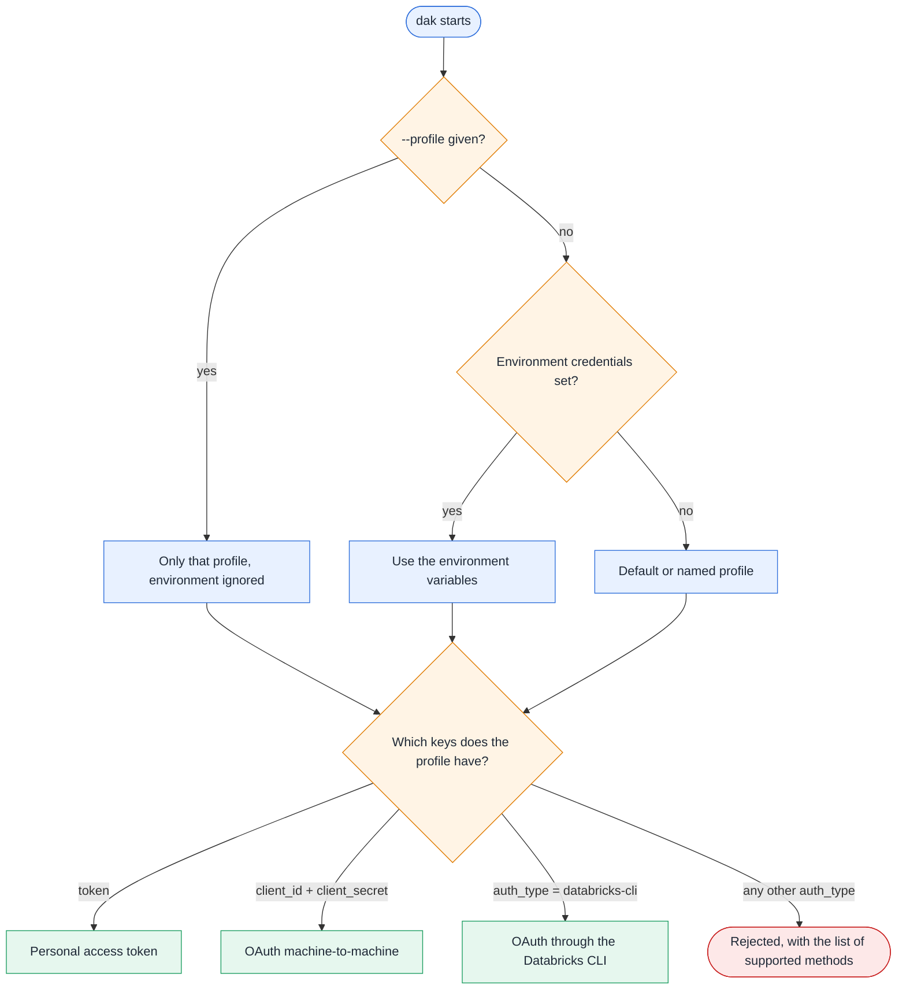

# Authentication

`dak` calls Databricks with the identity you configure, and every result is limited by that identity's permissions. This
page explains how the server picks its credentials, the three supported methods, and the privileges each capability
needs.

## How credentials are resolved

The server checks these sources in order and uses the first one that applies:



The host must use `https`. Plain `http` is accepted only for loopback test stubs. Tokens stay in memory, are refreshed
before they expire, and are sent only to the workspace host. They never appear in logs or tool output.

## Choose a method

| | OAuth through the CLI | Personal access token | OAuth M2M, service principal |
| --- | --- | --- | --- |
| Best for | Personal use on your machine | Quick tests, when tokens are allowed | Unattended runs and shared HTTP servers |
| Admin needed | No | Only if the workspace admin allows tokens | Yes, to create the principal and its secret |
| Renewal | The CLI refreshes; after the refresh token expires, log in again | Rotate by hand before it expires | Automatic |
| Who the agent acts as | You | You | The service principal |
| Recommended for agents | Yes, with a dedicated read-only identity if you can | Acceptable for tests | Yes, ideally read-only |

## Option A: OAuth through the Databricks CLI

Recommended for personal use.

1. Install or upgrade the Databricks CLI to 1.0.0 or later:
   - Windows: `winget install Databricks.DatabricksCLI` (or `winget upgrade Databricks.DatabricksCLI`).
   - macOS and Linux: see the [CLI installation guide](https://docs.databricks.com/aws/en/dev-tools/cli/install).
2. Log in once per workspace. This writes a profile with `auth_type = databricks-cli`:

   ```bash
   databricks auth login --host https://<workspace-host> --profile dev
   ```

3. Optional: pin a warehouse with `warehouse_id = <id>` in the `[dev]` section of `~/.databrickscfg`.
4. Start the server with `--profile dev`, or set `DATABRICKS_CONFIG_PROFILE=dev`.

`dak` runs `databricks auth token --profile dev` when it needs a token. The CLI keeps the token cache in
`~/.databricks/token-cache.json`. When the refresh token expires, tool calls return an error that asks you to run
`databricks auth login --profile dev` again. No server restart is needed.

## Option B: Personal access token

1. In the workspace, open your user menu, then **Settings**, **Developer**, **Access tokens**, **Manage**, and
   **Generate new token**. Set a lifetime and copy the token.

   Workspace admins can disable personal access tokens. If the option is missing, use option A or C.

2. Provide the token through the environment:

   ```bash
   export DATABRICKS_HOST=https://<workspace-host>
   export DATABRICKS_TOKEN=<token>
   ```

   or through a profile in `~/.databrickscfg`:

   ```ini
   [pat]
   host  = https://<workspace-host>
   token = <token>
   ```

3. Rotate the token before it expires. Keep `~/.databrickscfg` readable only by your user, and never commit tokens.

## Option C: OAuth M2M with a service principal

Use it for unattended work or a shared HTTP server. Some steps need a workspace or account admin.

1. Create a service principal and give it workspace access.
2. Generate an OAuth secret for it: admin settings, **Identity and access**, **Service principals**, the principal, then
   **Secrets**. Copy the client ID and the secret.
3. Grant it the privileges in the table below, ideally read-only.
4. Provide the values through `DATABRICKS_HOST`, `DATABRICKS_CLIENT_ID` and `DATABRICKS_CLIENT_SECRET`, or through a
   profile with `host`, `client_id` and `client_secret`.

`dak` exchanges them at `https://<workspace-host>/oidc/v1/token` with the `client_credentials` grant and scope `all-apis`,
and refreshes the token automatically.

## Privileges by capability

| Capability | Required |
| --- | --- |
| Any SQL tool | `CAN USE` on a SQL warehouse |
| Read data | `USE CATALOG`, `USE SCHEMA` and `SELECT` on the objects |
| `search_metadata`, tags in `describe_table` | Read access to `system.information_schema`, which shows only objects the identity can access |
| `describe_table` with `lineage` | Unity Catalog system tables (`system.access`) enabled by an admin, plus `SELECT` on them |
| Exports (`export` of `execute_sql`) | Nothing beyond the privileges to read the data. The workspace must allow `EXTERNAL_LINKS` results, the machine must reach the cloud-storage hosts, and the export directory must be writable |
| Writes (`--allow-writes`) | `MODIFY` and the DDL privileges you intend to allow |

::: warning The identity is the security boundary
Neither the Statement Execution API nor MCP offers a read-only mode. MCP tool annotations are only hints for the client.
The read-only check decides whether a statement reads; it does not limit what a read can reach. See
[the security model](/security) for the full picture.
:::

Give agents a dedicated identity, such as a service principal or a user or group used only for agents, with just what
they need:

- `CAN USE` on one SQL warehouse, and `USE CATALOG`, `USE SCHEMA` and `SELECT` on the data they may read.
- No `MODIFY`, `CREATE` or ownership on data objects, no `READ` on secret scopes and no `USE CONNECTION`. SQL functions
  such as `secret()` or `http_request()` could otherwise expose secrets or reach external services.

## Verify

```bash
dak doctor --profile dev
```

`dak doctor` runs the checks above and prints the next step for each failure. Its **Result download** check
only warns when the workspace gives no external link or the cloud-storage host is unreachable, because a proxy can allow
the workspace and block the storage host. Only the host name is printed.
