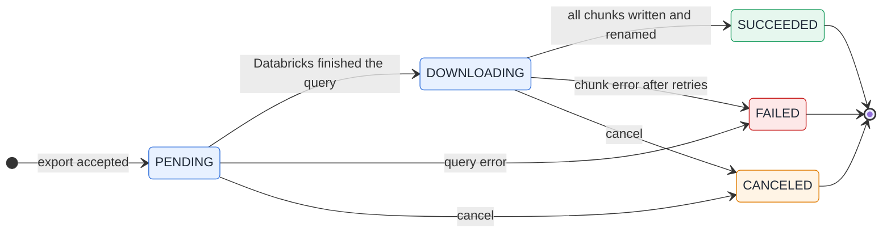

# Exporting results

Use `export` when a result is too large for the agent's context, or when another tool needs the data in a file. The rows
never travel through the agent: the server downloads them from Databricks and writes them to disk.

## Start an export

Pass `export` to `execute_sql`:

```json
{
  "statement": "SELECT * FROM main.sales.orders",
  "export": { "format": "parquet", "name": "orders" }
}
```

- `format` is `csv`, `parquet` or `sqlite`.
- `name` is an optional label. Characters outside `A-Z a-z 0-9 . _ -` become `_`, and the label is cut at 64 characters.
  The agent cannot choose a path.

The call returns at once with the `statementId` and an export descriptor (`id`, `format`, `path`, `status`). The export runs
in the background. `row_limit` and `DAK_MAX_ROWS` do not apply to an export. The size limit is `DAK_EXPORT_MAX_BYTES`
(default 10 GiB).

## Lifecycle



Follow the export with `get_statement`, using the `statement_id`. It returns the state under `export.status`:

| Status | Meaning |
| --- | --- |
| `PENDING` | The query is still running in Databricks |
| `DOWNLOADING` | Chunks are being downloaded. `progress` has `chunksDone`, `chunksTotal`, `rows` and `bytes` |
| `SUCCEEDED` | Done. `files`, `rows`, `bytes` and `truncated` are set |
| `FAILED` | Failed. `error` has the reason, and no partial file is left behind |
| `CANCELED` | Cancelled. The partial files were deleted |

Pass `wait_seconds` (0 to 30) to wait for the export to end before the answer, instead of polling. Pass `cancel: true` to
cancel the statement in Databricks, stop the download and delete the partial files.

When the result is larger than `DAK_EXPORT_MAX_BYTES`, Databricks cuts it. The export still ends `SUCCEEDED`, with
`truncated: true`.

## Formats

| Format | Result | Notes |
| --- | --- | --- |
| `csv` | `<id>.csv` | One file, however many chunks Databricks returns. One header line |
| `parquet` | `<id>/part-00000.parquet`, `part-00001`, ... | One ZSTD-compressed file per chunk, in a directory. `DECIMAL`, `TIMESTAMP`, `STRUCT` and `ARRAY` keep their types |
| `sqlite` | `<id>.db` | One file with the table `result` |

Each output is written under a temporary name (`<id>.csv.part`, `<id>.db.part`, or the directory `<id>.part/` for Parquet)
and renamed when complete. An unfinished export never looks finished.

The export identifier is `<name or "export">-<full statement id>`. If the target already exists, the export is rejected
with `Export <path> already exists; choose another name.`, and its statement is cancelled in Databricks.

## Where the files go

Every export is written under `DAK_EXPORT_DIR`. Its default is `<log storage>/exports`, see
[configuration](/guide/configuration). A relative `DAK_EXPORT_DIR` is resolved against the working directory of the server
process, so prefer an absolute path.

Outside Windows, the server creates the directory with mode `0700`. Anyone who can read the directory can read the exports.
In HTTP mode the files are on the server machine.

## Caveats

- **CSV `NULL`.** Databricks writes SQL `NULL` as the text `null`, and `dak` does not change the bytes it receives. A `NULL`
  cannot be told apart from the string `"null"`. Use Parquet or SQLite when the difference matters.
- **SQLite types.** Values arrive as text, and the column affinity converts them:

  | Databricks type | SQLite column | Conversion |
  | --- | --- | --- |
  | `TINYINT`, `SMALLINT`, `INT`, `BIGINT` | `INTEGER` | None. `BIGINT` stays exact |
  | `BOOLEAN` | `INTEGER` | `true` becomes 1 and `false` becomes 0 |
  | `FLOAT`, `DOUBLE` | `REAL` | None |
  | `DECIMAL` of 15 digits or fewer | `REAL` | None |
  | `DECIMAL` of more than 15 digits | `TEXT` | None, so no precision is lost |
  | `DATE`, `TIMESTAMP`, `STRING` | `TEXT` | None |
  | `STRUCT`, `ARRAY`, `MAP` | `TEXT` with JSON | None. Query them with `json_extract` |
  | Anything else, such as `BINARY` and intervals | `TEXT` | None |

  An empty column name becomes `column_<position>`. A repeated name gets the first free suffix `_2`, `_3`, and so on, because
  SQLite compares names without case. SQLite allows at most 2000 columns.

- **No resume, no deletion.** Exports live in the server process. If it restarts or stops, a running export is lost, and
  `dak` does not resume it: run the statement again. On a clean shutdown, its partial files are deleted. `dak` never
  deletes a finished export. At startup it removes `.part` leftovers older than 24 hours.
- **Presigned links.** Result chunks come from cloud storage, not from the workspace host. A proxy or firewall that allows
  the workspace can still block them. `dak doctor` reports this under **Result download**.
- **Download retries.** A network error, `429` or `5xx` is retried up to three times, after 500 ms, 1 s and 2 s. A `403` or
  an expired link gets one fresh link. Anything else fails the export.

Error messages and fixes are listed in [troubleshooting](/guide/troubleshooting#exports).
