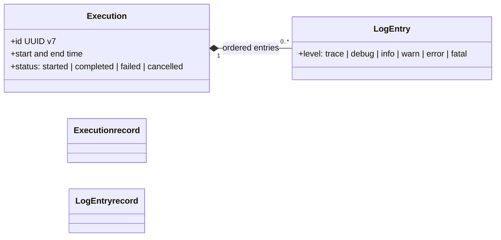

# Operational logs

`dak` records what it does in a local SQLite store, so you can diagnose a failed call or review what an agent ran. The
agent can read the logs through MCP resources, and you can read the file directly.

## Where they live

The store is `logs.db` in a per-user state directory:

| Platform | Directory |
| --- | --- |
| Windows | `%LOCALAPPDATA%\databricks-agent-kit` |
| Other systems | `$XDG_STATE_HOME/databricks-agent-kit`, by default `~/.local/state/databricks-agent-kit` |

Set `DAK_STORAGE_DIR` to use another directory. Every `dak` process of the same user shares the store. Outside Windows, the
directory is `0700` and the file is `0600`, so only its owner can read it. Logs written by earlier versions in
`<install dir>/.storage` are not migrated.

## Data model

- Every tool call is an **execution**, with a start and end time, a status and its ordered entries.
- Each export runs as its own execution.
- Server start and stop events belong to a lifecycle execution per process.
- Reading the log resources opens no execution. Diagnosing therefore does not inflate the statistics it reports.
- `resource://databricks/warehouses` is recorded like a tool call.
- If the process dies during a call, its execution stays as `started`.

## What is logged

- **One entry per call**, written when the call ends at `info` level: the tool name, its arguments, the duration and a
  summary of the result (`statementId`, `warehouseId`, state, row count, `truncated`, and `checkMs` for the read-only check).
- **SQL text** is logged and cut at 4096 characters.
- **Never logged:** parameter values (only their name and type), result rows, tokens or secrets. Keys such as `token`,
  `secret`, `password` and `authorization` are redacted.

## Levels

- An expected failure, a `DakError` such as a read-only violation, an invalid argument, `PERMISSION_DENIED` or bad SQL, is
  one `warn` entry without a stack trace.
- An unexpected error is one `error` entry with its stack trace.
- Retries of Databricks requests and export downloads are `warn`.
- The automatic warehouse choice, and the start and end of an export, are `info`.
- Token refreshes, every Databricks request and every written export chunk are `debug`.
- Repeated `401` rejections on the HTTP transport produce one `warn` per minute, with a counter.

`DAK_LOG_LEVEL` (`trace`, `debug`, `info`, `warn`, `error`, `fatal`; default `info`) filters what is stored.

## Writes and retention

Entries go through an in-memory queue. It is flushed every 5 seconds, every 100 events in one transaction, and on shutdown.
If the process crashes, only the events still in the queue are lost.

Entries are kept for 90 days. The store is purged at startup and every 24 hours.

## Reading the logs through MCP

| Resource | Content |
| --- | --- |
| `resource://logs/errors/recent` | Latest error and fatal entries |
| `resource://logs/executions/recent` | Latest executions |
| `resource://logs/execution/{executionId}` | One execution with all its entries |
| `resource://logs/stats` | Executions, errors and warnings in the last 24 hours |

There is no log search tool. The log costs no context until an agent reads one of these resources. In HTTP mode, every
client sees the calls of every other client, SQL text included.
