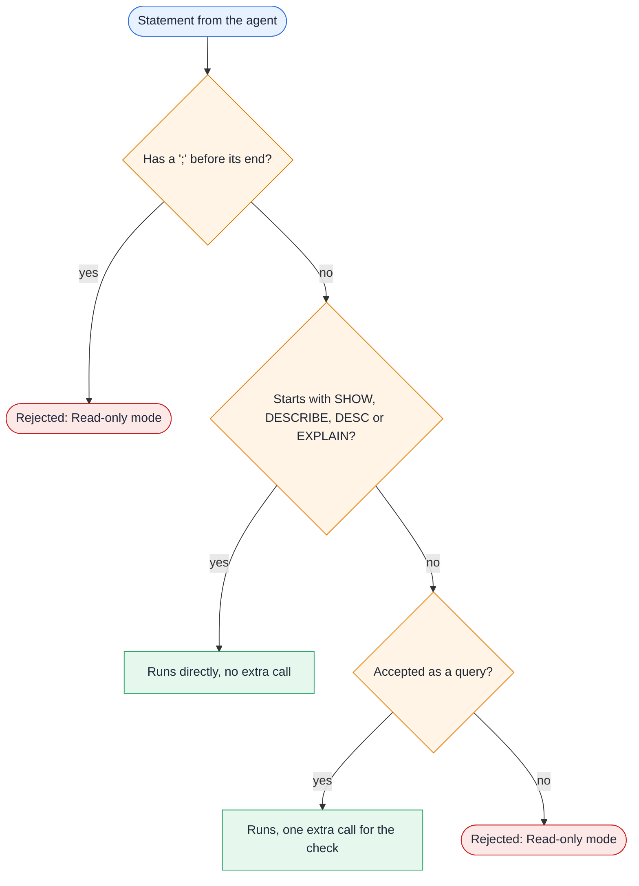

# Read-only mode and SQL safety

`dak` starts in read-only mode. Every statement the agent sends, including the statement of an export, goes through a
check before Databricks runs it. The check is defense in depth. It is not the security boundary: the permissions of the
identity are. Read this page with [the security model](/security) in mind.

## What read-only mode allows

- **Queries:** `SELECT` and `WITH` statements, and any statement that Databricks accepts as a query.
- **Inspection commands:** `SHOW`, `DESCRIBE`, `DESC` and `EXPLAIN`, under the conditions below.

Everything else is rejected with a `Read-only mode` message, and no statement reaches the warehouse.

## How a statement is checked



1. **Semicolons.** A statement with a `;` before its end is rejected, whether it holds several statements or a `;` inside
   a string literal. The check cannot tell the two apart. A single trailing `;` is fine. To use a literal that contains
   `;`, pass it as a `:name` parameter.
2. **Inspection commands.** `SHOW`, `DESCRIBE`, `DESC` and `EXPLAIN` run directly, without an extra call, only when the
   keyword is the first word of the statement. Leading spaces, tabs and line breaks are allowed. A keyword followed by `:`
   (a SQL scripting label) does not qualify. Comments are not skipped on purpose: a scanner that disagreed with the
   Databricks lexer could let a write through.
3. **Everything else** must pass `DESCRIBE QUERY <statement>`. Databricks accepts this only for queries, such as `SELECT`
   or `WITH`. A statement that does not parse as a query is rejected. This includes a `SHOW`, `DESCRIBE` or `EXPLAIN`
   that starts with a comment: remove the comment.

Databricks parses each statement itself, so comments, string literals and dialect features cannot hide a write, and the
check never executes the statement.

## What read-only mode does not stop

- **Reads outside your intent.** A read can reach any table the identity can read. The check does not limit which tables
  a query touches.
- **Functions inside a query.** The check does not block functions such as `secret()` or `http_request()`. Only the
  identity's privileges do: no `READ` on secret scopes, and no `USE CONNECTION`.
- **Prompt injection.** Everything the identity can read can reach the agent's context, and through it any other tool
  the agent has, such as a shell or a web fetch. Table comments and data are untrusted input.

For the privileges that close these gaps, see [authentication](/guide/authentication#privileges-by-capability).

## Enabling writes

Writes are off. Enable them only when they are intended:

```bash
dak mcp --profile dev --allow-writes
```

or set `DAK_ALLOW_WRITES=true`. Writes still need the Unity Catalog privileges to match, such as `MODIFY` and the DDL
privileges you allow. An export goes through the same check, so an export of a write statement is rejected in read-only
mode.

## Troubleshooting a rejection

| Message | What to do |
| --- | --- |
| `Read-only mode: ...` with a statement that is a query | Remove a leading comment, or move literal `;` characters into `:name` parameters |
| `Read-only mode: ...` for a write | Expected. Restart with `--allow-writes` only if writes are intended |
| `Read-only check did not finish ...` | The warehouse is starting. Retry in a moment |

More cases are in [troubleshooting](/guide/troubleshooting).
