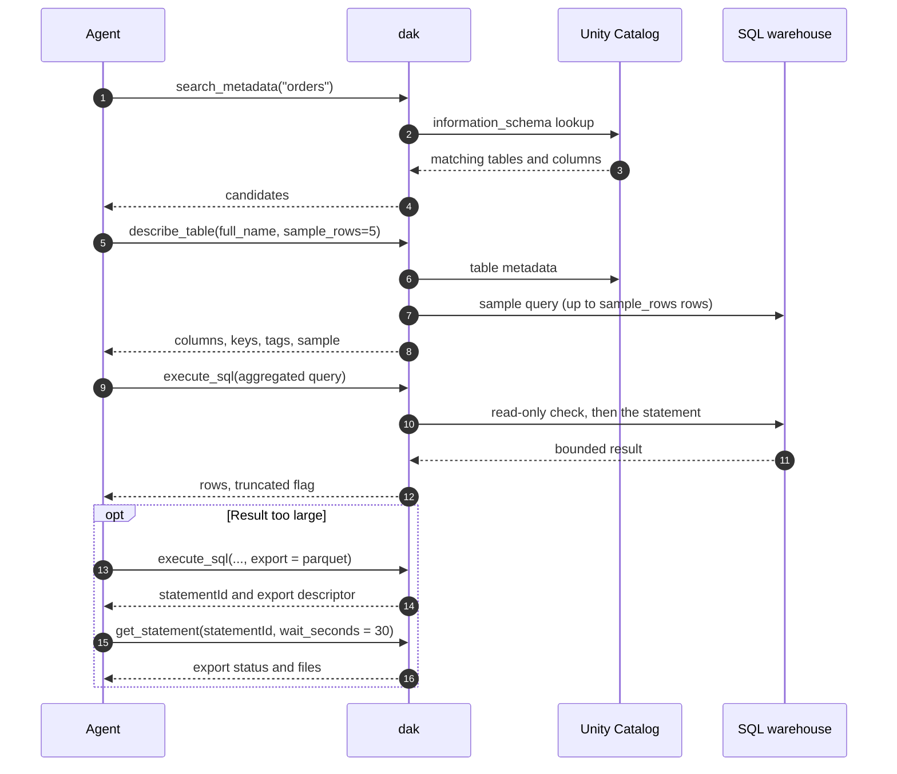

# Tools

`dak` exposes five tools. The definitions stay under 2,500 characters in total, so they cost little context in every
session.

| Tool | Parameters | Purpose |
| --- | --- | --- |
| `list_objects` | `catalog?`, `schema?`, `pattern?`, `limit?` | Without arguments, catalogs. With `catalog`, its schemas. With `catalog` and `schema`, its tables. `pattern` is a substring or a glob |
| `describe_table` | `full_name`, `sample_rows?`, `lineage?` | Columns, comments, primary and foreign keys, clustering, partitioning and tags. Optional sample (at most 100 rows) and upstream or downstream lineage |
| `search_metadata` | `query`, `catalog?`, `limit?` | Find tables and columns by name or comment |
| `execute_sql` | `statement`, `parameters?`, `catalog?`, `schema?`, `row_limit?`, `warehouse_id?`, `export?` | One statement with `:name` parameters and bounded results. With `export`, the full result goes to a file |
| `get_statement` | `statement_id`, `wait_seconds?`, `cancel?` | Follow up a statement still running after 30 seconds, or an export. `wait_seconds` goes from 0 to 30. `cancel: true` cancels it |

## The usual workflow

Data questions follow the same path. The tools are designed for it, and they replace Genie for this purpose.

Aggregate in SQL when the result is large, and pass `export` when you need the full data in a file. The better your Unity
Catalog comments, tags and keys, the better the agent's SQL.

## Details the table leaves out

- **`list_objects`** returns `truncated` when more objects matched than `limit` (default 100, maximum 500). `schema` without
  `catalog` is an error.
- **`search_metadata`** returns 50 matches by default, and at most 200.
- **`describe_table`** reports a sample or a lineage that could not be read in `notes` instead of failing. Lineage comes
  from `system.access.table_lineage`, which an admin must enable. See [authentication](/guide/authentication#privileges-by-capability).
- **`execute_sql`** takes `parameters` as a list of `{ name, value, type? }`. The value goes through the API and is never
  interpolated into the SQL text.
- **`get_statement`** follows any statement that is still running. A statement that runs longer than 30 seconds returns
  its `statement_id` so you can wait for it.

## Results and limits

- Results hold 100 rows by default. `row_limit` sets the number of rows, up to `DAK_MAX_ROWS` (default 1000).
- The result is also capped by size, at 100 KB.
- Both limits are applied by Databricks (`row_limit` and `byte_limit` of the Statement Execution API) and again by `dak`.
  A `LIMIT` clause is not needed, and a large result never floods the agent's context.
- `truncated: true` tells the agent to aggregate, filter or export.

The read-only check that runs before every statement is covered in [read-only mode](/guide/read-only).
