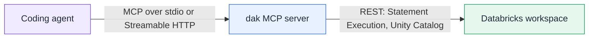

## What it is

`dak` is a [Model Context Protocol](https://modelcontextprotocol.io) server. Your coding agent calls five tools to answer
questions about data in Databricks: it finds the right table, looks at its structure and a sample, and runs a bounded SQL
query. The server talks only to public Databricks REST APIs.

## What it is not

- **Not a model.** Databricks-served models, AI Gateway, Unity Gateway and Genie are out of scope. Your agent keeps its own
  model subscription.
- **Not a security boundary by itself.** The read-only check is defense in depth. The permissions of the identity you
  configure in Unity Catalog decide what can be read or changed.
- **Not a Databricks-managed MCP server.** It runs on your machine, or on a host you control.

## How it fits together

## Where to go next

- New here? Start with the [quickstart](/guide/quickstart).
- Choosing how `dak` signs in? Read [authentication](/guide/authentication) and compare the three methods.
- Setting up an agent? See [connecting your agent](/guide/agents).
- Wondering what the agent may or may not do? Read [read-only mode](/guide/read-only) and the [security model](/security).
