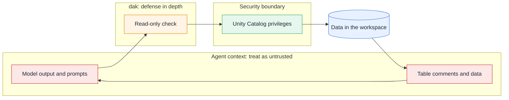

# Security model

`dak` is designed so that an agent gets governed access to data, and so that a mistake or a manipulated prompt does less
damage. This page lists what protects the data, what does not, and what you have to do.

## Where the boundary is

The **Unity Catalog privileges of the identity are the security boundary.** Neither the Statement Execution API nor MCP offers
a read-only mode, and MCP tool annotations are only hints to the client. The read-only check decides whether a statement
reads. It does not limit what a read can reach.

## What protects the data

- **Read-only by default.** Every statement is checked before it runs, and writes need `--allow-writes`. See
  [read-only mode](/guide/read-only).
- **Databricks parses each statement.** Comments, string literals and dialect features cannot hide a write, and the check
  never executes the statement.
- **Parameters are not interpolated.** Values in `execute_sql` go through the API as parameters, never into the SQL text.
- **Tokens stay in memory.** They are refreshed before they expire, sent only to the workspace host, and never written to
  logs or tool output.
- **Redacted logs.** Parameter values, result rows, tokens and keys such as `token`, `secret`, `password` and `authorization`
  are not stored.
- **Limits.** Results are capped in rows and bytes, by Databricks and again by `dak`, so a large result never floods the
  agent.

## What does not protect the data

- **Reads are not limited by the check.** A read can reach any table the identity can read. Keep the identity's privileges
  narrow.
- **Functions inside a query are not blocked.** `secret()` and `http_request()` run if the identity may use them. Deny
  `READ` on secret scopes and `USE CONNECTION` to agent identities.
- **Prompt injection.** Everything the identity can read can reach the agent's context, and through it any other tool the
  agent has, such as a shell or a web fetch.
- **Data on disk.** The operational logs hold SQL text (cut at 4096 characters), so literals in a query are stored there
  for up to 90 days. Exports are plain files: CSV, Parquet or SQLite, without encryption.

## Transports

- **stdio** runs one process per agent session, with no network listener.
- **Streamable HTTP** listens on `127.0.0.1:8765` by default. It rejects requests with a foreign `Host` header (DNS
  rebinding protection) and, on loopback, browser requests from a non-local `Origin`.
- **Off loopback**, binding needs `DAK_HTTP_TOKEN` (at least 32 characters). Clients send it as `Authorization: Bearer`.
- **TLS is not built in.** Off loopback, put the server behind a TLS-terminating reverse proxy, so the token is not sent in
  clear text.
- **One identity for all clients.** Everyone connected to a shared server uses its Databricks identity, and sees the logs of
  every other client.

## What you should do

1. Create a **dedicated identity** for agents: a service principal, or a user or group used only for agents.
2. Grant `CAN USE` on one SQL warehouse, and `USE CATALOG`, `USE SCHEMA` and `SELECT` only on the data the agent may read.
3. Do not grant `MODIFY`, `CREATE`, ownership, `READ` on secret scopes, or `USE CONNECTION` to that identity.
4. Keep writes off unless you intend to change data.
5. Use OAuth through the CLI or a service principal, not a long-lived personal token, where the workspace allows it. See
   [authentication](/guide/authentication).
6. Set a 32-character or longer `DAK_HTTP_TOKEN` and a TLS proxy before exposing the HTTP transport beyond loopback.
7. Point `DAK_EXPORT_DIR` to a directory that only you can read, and delete exports you no longer need.
8. Run `dak doctor` after every change to confirm the setup.
